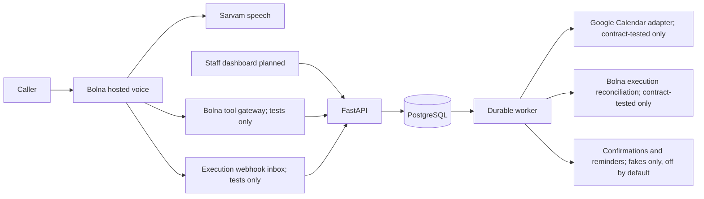

# Architecture

Use a modular monolith with API and worker processes sharing PostgreSQL. Bolna handles telephony and voice orchestration; Sarvam remains behind Bolna's provider interface. No Redis is needed for the initial backend: PostgreSQL owns reservations, durable jobs, and later webhook inbox records. Add infrastructure only when measured demand justifies it.

FastAPI, PostgreSQL, local reservations, the outbox and its worker exist today. The worker talks to the in-process `FakeCalendar` (refused outside `_test`/`_dev` databases unless `APP_ENV=development`) or, with `--calendar google`, to the Google Calendar adapter (T5). The Google adapter and OAuth flow are verified only against `httpx.MockTransport` contract fixtures built from the official documentation; no live Google account has been connected. Confirmation messages and reminder calls/messages (T9) run only against `FakeMessaging` and `FakeBolna` in tests; no messaging provider exists and `outbound_enabled` is off by default. The other provider arrows are planned integration boundaries.

## Booking consistency

PostgreSQL is the authoritative reservation ledger. `appointments` uses a GiST exclusion constraint on clinic, doctor, and the `[starts_at, blocks_until)` timestamp range, where `blocks_until` is `ends_at` plus the service buffer snapshotted at booking time (later buffer edits do not move existing holds). This blocks overlapping pending/confirmed/review reservations across services and processes. A unique tenant/idempotency key plus a canonical body hash makes retries replay the same appointment or reject a changed request. A transaction commits the reservation and `calendar.create` outbox entry together. Slot discovery is advisory. A short doctor-row lock orders reservation writes and avoids exclusion-check deadlocks between simultaneous inserts; the range constraint remains the final invariant for every database writer. Schedule exceptions (holidays, leave, breaks) are not covered by the exclusion constraint; instead exception creation takes the same doctor row lock (every clinic doctor in id order for clinic-wide exceptions) and reservations re-check slots, which include exceptions, under that lock, so whichever commits first wins. Existing appointments that overlap a new exception are reported, not cancelled. All scheduling writers follow one lock order, defined in `locks.py`: the reservation's action advisory lock, then the per-clinic doctor-set advisory lock (`doctors:<clinic>`; shared by doctor creation, exclusive for clinic-wide exceptions, so a doctor cannot appear half-way through one), then doctor rows in ascending id. Slot candidates step in absolute (UTC) time from each local opening, so DST transitions neither offer nonexistent local times nor duplicate instants; reservations compare instants. `blocks_until` is derived data: any future reschedule, duration change or status transition back to an active status must recompute it from the booked service's buffer in the same transaction. Migration 005 gives `blocks_until` no default, so a binary older than 005 fails its appointment insert after the migration applies; deploy the new binary with (or before traffic resumes after) the migration. No provider I/O runs under this lock.

The reservation API returns 202 `pending_sync`, without patient data. The worker below moves it to `confirmed` (or `needs_review`); without a live calendar adapter no real calendar is written, so do not enable pilot traffic yet.

### Durable worker (implemented, migration 007)

`outbox.py` holds the job machinery (claim, lease renewal, fencing, retry, dead-letter, release, `run_batch`/`run_once`/`run_loop`); `handlers/` holds the registry (`HANDLERS`: kind to `Handler(run, on_dead)`) and `handlers/calendar.py` the three calendar handlers. Neither imports FastAPI. `claim()` runs in one committed transaction on the database clock: it first dead-letters processing jobs whose lease expired after they used all their attempts (`lease_expired`, running the kind's `on_dead` hook), so a job that keeps killing workers cannot loop forever; then it leases up to `limit` jobs with `FOR UPDATE SKIP LOCKED` over pending jobs with `available_at <= now()` and processing jobs whose `lease_expires_at < now()` that still have attempts left, ordered by `available_at`, setting `processing`, `attempts + 1`, `lease_owner` and `lease_expires_at = now() + lease` (default 2 minutes). Just before a job starts its lease is renewed with a fenced update and the job is skipped if that fails (it was reclaimed while waiting in the batch); handlers renew again between provider calls (`renew()`). Adapter timeouts must stay well under the lease: `check_ports()` requires every calendar adapter except the in-process `FakeCalendar` to declare a positive `timeout_seconds` of at most a quarter of the lease. `complete`, `retry`, `fail_dead`, `renew` and `release` are fenced on `(id, clinic_id, lease_owner, attempts, status='processing')` and return False when the lease was lost; the caller then does nothing more. `attempts` never decreases (requeue and `release()` on shutdown extend `max_attempts` instead), so a fence value is never reused. Retry backoff is `min(30 s * 2^(attempts-1), 1 h)` or the provider's `retry_after` (capped at one hour); once `attempts >= max_attempts` (default 8) `retry` dead-letters instead. Dead-lettering runs the kind's `on_dead` hook in the same transaction; for `calendar.create` it moves the appointment to `needs_review` only if it is still `pending_sync` at the job's `appointment_version`. `last_error` holds fixed short codes (`timeout`, `retryable`, `provider_permanent`, `provider_error`, `external_conflict`, `calendar_unmapped`, `event_mismatch`, `event_missing`, `appointment_past`, `lease_expired`, `lease_lost`, `bad_payload`, `not_found`, `unknown_kind`, `internal`), never provider text; logs carry job id, kind and code or exception type only.

Provider I/O always runs with the worker connection idle: every read transaction commits before the call (`require_idle` raises otherwise) and each outcome is a separate short transaction. `calendar.create`: load the appointment and doctor. If it was cancelled or its `version` differs from the job's, it is superseded: if the job recorded write intent (an attempt may have inserted), cancel this job's own event id in that calendar first; otherwise complete as a no-op. If it is `confirmed` or `needs_review` at the job's version, complete. An unmapped doctor dead-letters `calendar_unmapped`. Then `get_event(event_id_for(appointment, version))` first, so an ambiguous earlier write is recovered by reading the id: a confirmed event with matching start/end confirms; a cancelled or mismatched one dead-letters `event_mismatch`. If absent and the appointment has already started (database clock), dead-letter `appointment_past`. The job's target calendar is the write intent an earlier attempt recorded in its payload (`calendar_id`, stored with a fenced lease renewal just before every insert), else the calendar recorded with this event, else the doctor's current booking calendar; so a retry after a booking-calendar remap recovers in the calendar it originally wrote to. Otherwise FreeBusy on the doctor's `busy_calendar_ids` (the booking calendar excluded, since it holds this system's own projections) is re-checked over the appointment hold `[starts_at, blocks_until)`, the same interval slot math uses; any overlap dead-letters `external_conflict` with no insert. Then `insert_event`; `EventAlreadyExists` (another attempt's write landed in between) re-reads and verifies, `ProviderTimeout` retries (the next attempt starts with `get_event`), `ProviderRetryable` retries with its delay, `ProviderPermanent` dead-letters. Confirmation sets `status='confirmed'`, `calendar_event_id` and `calendar_id` (migration 008: the calendar the event was written to) (guarded by `pending_sync` and version) and completes the job in one transaction, rolled back if the fence fails. If the appointment was cancelled or rescheduled while the event was being written, the job cancels the event it just wrote (idempotent) and completes. That cancel runs even if this worker's lease was lost, because the id belongs only to the superseded version; only the bookkeeping is fenced, so a stale worker's late insert never survives; a provider error there retries the job, whose next attempt sees the superseded appointment and cancels again. If staff moved it to `needs_review` at the same version mid-write, the event id is recorded and the job completes. `calendar.cancel` targets the job's version: the payload's `event_id`, else the recorded `calendar_event_id` only while the appointment is still at that version (after a reschedule it names the new event, which must survive), else `event_id_for(appointment, job version)`; the calendar is the payload's, else the one recorded with that event, else that version's create write intent, else the current booking calendar; cancelling is idempotent. `calendar.refresh_busy` (payload `doctor_id`, `start`, `end`; no appointment) runs `refresh_external_busy` with a heartbeat that renews the lease between per-calendar fetches (a lost lease raises `LeaseLost` before any write and the job retries fenced, normally a no-op) and commits its cache writes with the fenced completion; an unknown doctor raises the domain `errors.NotFound` (mapped to 404 by api.py where it reaches HTTP) and dead-letters `not_found`. Other kinds allowed by the CHECK (notifications, reminders, webhooks, reconciliation, provisioning) have no handler yet and dead-letter `unknown_kind`; nothing enqueues them. Each job is processed independently and unexpected exceptions retry with `internal`, so one bad job never stops the batch.

Migration 007 adds `appointments.version` (default 1), `calendar_event_id`, `updated_at`; `outbox.appointment_version`, lease columns, `last_error` (at most 64 characters), `payload`, `updated_at`, `max_attempts`; replaces `UNIQUE (appointment_id, kind)` with `UNIQUE (appointment_id, kind, appointment_version)` so a future reschedule can enqueue a new create; makes `appointment_id` nullable except for `calendar.create`/`calendar.cancel`; and requires a lease on processing rows. Reschedule (milestone 2) must bump `version`, which changes the event id. Never un-cancel an appointment or reuse a version: any restore of a cancelled appointment must bump the version, because withdrawal of a superseded event (including by a stale worker) relies on a version-scoped event id never naming a live booking.

Remaining gaps: the Google adapter is not yet validated against a live account; no reconciliation of human calendar edits or deletions after confirmation; cancels and reschedules (T7) enqueue `calendar.cancel`, but nothing enqueues `calendar.refresh_busy` yet; a crashed worker's job waits for its lease to expire. The generic `/v1/tools/appointment-status` reveals the status of any appointment UUID within the caller's tenant; the gateway's status tool is bound to the call session (appointments created or verified in that call). The `UNIQUE (appointment_id, kind, appointment_version)` key allows one job per kind per version, so kinds with several jobs per appointment version (multiple reminders, T9) will need a `dedupe_key` column in that key.

Google FreeBusy is not a distributed lock. Before a pilot choose an explicit ownership policy: a clinic-managed dedicated booking calendar plus external busy-calendar reads is preferred. Human edits and external systems can race our ledger; incremental sync/reconciliation and a manual conflict policy are required. Never imply a database constraint prevents external calendar races.

### Calendar port and external busy cache (implemented, ADR 0004)

`providers/calendar.py` defines `CalendarPort` (`get_event`, `insert_event`, `cancel_event`, `free_busy`), the error classes `ProviderTimeout` (outcome unknown), `ProviderRetryable`, `ProviderPermanent` and `EventAlreadyExists` (codes only, never provider bodies), `event_id_for(appointment_id, version)` (`cv<uuid hex>v<version>`; Google allows event ids of 5-1024 characters from base32hex, a-v and 0-9, and the id stays inside that set) and an opaque `event_summary`. `FakeCalendar` is a thread-safe in-memory adapter with timeout and failure injection for tests. No live adapter exists yet (milestone 1, T5); the worker consumes the port.

Migration 006 adds `doctors.booking_calendar_id` (the dedicated calendar the system writes to; NULL = not mapped) and `doctors.busy_calendar_ids` (up to 10 read-only advisory calendars), plus the `external_busy` cache (clinic, doctor, interval, source, `fetched_at`). `calendar_sync.refresh_external_busy` needs an idle, non-autocommit connection (it raises `RuntimeError` otherwise, so no provider call runs inside a caller's transaction), reads the doctor and the database clock, commits that read, and queries FreeBusy once per calendar (the doctor's busy calendars plus the booking calendar, whose own events then appear busy; harmless because those times are already blocked locally) so each cached row records its real `source_calendar`. In the write transaction it first takes the standalone advisory lock `busy:<clinic>:<doctor>` (a namespace separate from `doctors:<clinic>` and idempotency keys; never held with doctor row locks), skips the write and returns False if a refresh that began fetching later already wrote an overlapping row, prunes rows that ended in the past, deletes cached rows fully inside the window, trims rows straddling a window edge (splitting one that covers the whole window) so out-of-window busy time survives, and inserts the fresh clipped intervals. Provider errors propagate before any write. `calendar_ids_valid()` (migration 006) must never be `CREATE OR REPLACE`d: a rule change needs a new function and constraint in a new migration. `busy_intervals` unions the cache, so `check-slots` and the reservation re-check under the doctor lock treat cached external busy time like any other busy interval (a reservation over it returns 409). The cache is advisory and as stale as its last refresh; the worker's `calendar.refresh_busy` job can refresh it, but nothing schedules that job yet.

### Google Calendar connection and adapter (implemented, migration 009; not live-validated)

`calendar_accounts.py` runs the OAuth authorization code flow with PKCE. `POST /v1/admin/calendar/google/start` (owner/admin) stores a single-use state as a SHA-256 digest (ten-minute expiry) with the encrypted PKCE verifier and returns Google's authorization URL (`access_type=offline`, `prompt=consent`, `include_granted_scopes=false`, scopes `calendar.events` and `calendar.freebusy`, S256 challenge). The browser returns to `GET /v1/oauth/google/callback`, which has no bearer token but is bound to that state: the state is marked used atomically (`UPDATE ... WHERE used_at IS NULL AND expires_at > now()`) and committed before the code exchange, the starting user must still be an active owner/admin, and the clinic comes from the state row, never from the request. The token response must contain a refresh token and both scopes, otherwise nothing is stored and the grant is discarded, not revoked: Google documents revocation as grant-wide (every token of that user for this project), so revoking a rejected grant could disable an account the same Google user already connected. The refresh token is stored as AES-256-GCM ciphertext (`crypto.Keyring`, associated data `calendar_account:` + clinic id + account id) in `calendar_accounts`; revocation (`DELETE /v1/admin/calendar/google/{id}`) marks the row revoked at once (it stops being used) and enqueues a `calendar.revoke_grant` outbox job (migration 010); the Google worker decrypts the token, calls Google's revoke endpoint, and only after Google confirms (200, or 400 `invalid_token` for an already invalid token) clears the ciphertext in the transaction that completes the job. Failures retry with backoff and finally dead-letter with the ciphertext kept. When Google rejects a refresh token (`invalid_grant`, code `auth_revoked`) the worker marks the account `error` in a short committed transaction; it is then unmapped like a revoked account until staff reconnect. Start returns 409 while the clinic has an active account unless `?replace=true`; the callback repeats that check (before the code exchange, and again under a per-clinic advisory lock before storing) so concurrent starts cannot leave two active accounts. A replacing callback retires the previously active account(s) after storing the new one: status revoked, ciphertext cleared, audit `calendar.account_replaced`, and no Google revocation, because a grant-wide revoke would also kill the new account when the same Google user reconnected. An explicit DELETE does revoke at Google, which also invalidates any other account connected with the same Google user. A callback (under the same lock) forgets the tokens of this clinic's disconnected accounts whose revocation has not run and marks their pending `calendar.revoke_grant` jobs done (`revoke_superseded`); the revoke handler takes that lock too and skips Google when an active account was connected after the disconnect, committing before the Google call (a small window between check and call is accepted).

`providers/google_calendar.py` implements `CalendarPort` over Calendar API v3 with an injected `httpx.Client`: refresh-token grant with in-memory access-token caching (until 60 s before expiry), one refresh-and-retry on 401, deterministic event ids, opaque summary, `transparency: opaque`, `extendedProperties.private.appointment_ref`, `sendUpdates=none`. Error mapping is documented in the module: 409 on insert is `EventAlreadyExists`; get maps 404 to None and 410 or `status: cancelled` to a cancelled event; delete treats 410 as success and 404 as success only after an events list on the same calendar returns 200 (otherwise `ProviderPermanent('calendar_not_found')`: the event may still exist in a calendar these credentials cannot see); freeBusy per-calendar `errors` are `ProviderPermanent` (`notFound`) or `ProviderRetryable`; 429, 5xx and 403 rate-limit reasons are retryable with Retry-After; other 4xx are permanent. A timeout on a write is `ProviderTimeout` (outcome unknown, recovered by fetching the deterministic id); on a read or before the request was sent it is `ProviderRetryable`.

The worker resolves a port per job: `Ports(calendar_for=GoogleCalendarResolver(...))` maps (clinic, doctor) to the doctor's `calendar_account_id`, or, when the doctor has none, to the clinic's only active Google account (none or several: unmapped). A doctor mapped to a revoked account never falls back to another account. No usable account is handled like an unmapped calendar (`calendar_unmapped`, so a create moves the appointment to `needs_review`). Handlers stay provider-agnostic (`Ports.calendar_port`). The account that wrote an event is recorded: in the create job's write intent (`payload.calendar_account_id`, next to `calendar_id`) before the insert, and in `appointments.calendar_account_id` (migration 010) on confirmation. Withdrawals and cancels use that account (payload, then appointment, then the create job's intent) and fall back to the doctor's current mapping only when nothing was recorded; if the recorded account was revoked or replaced, the doctor's current active mapping is used instead (a DELETE 404 still only counts when the calendar is reachable with that account); if it is in status `error` or missing, the job dead-letters `calendar_unmapped` (a create also moves the appointment to `needs_review`). The resolver caches one adapter per account, replaced when the ciphertext changes and evicted when the account stops resolving. The worker loop prunes expired OAuth states of all clinics when idle, at most every ten minutes.

## Planned tenant boundary

Each tool bearer token is a `tenant_credentials` record owned by exactly one clinic (ADR 0002); tenant identity is never read from tool arguments. All current catalog/appointment reads filter by clinic; composite foreign keys prevent cross-clinic doctor/service references. Staff users and sessions (ADR 0003) belong to one clinic, and staff management derives the tenant from the session. This is still not complete multi-tenant auth: next put clinic configuration behind these roles, then add gateway-verified call/session context. Consider PostgreSQL RLS as defense in depth, with isolated role tests, before a pilot.

Caller ID is untrusted. Do not greet with private booking information or allow cancellation using only a phone number. Add a clinic-approved verification mechanism and handle shared phones. Never ask an LLM to decide tenant identity or invent idempotency keys.

## Provisioning and lifecycle

Plan onboarding as a recoverable state machine: draft → calendar_connected → agent_created → number_assigned → verified → active, with failed/manual-review states. Persist provider IDs after each step, reconcile uncertain results, and never buy a second number on a blind retry. Connect existing clinic numbers only after routing ownership is verified.

Booking lifecycle (implemented, T7, ADR 0006): pending_sync → confirmed or needs_review (worker); any active status → cancelled (voice cancel after verification and read-back, staff cancel, staff resolve) with `version` + 1 and a `calendar.cancel` job for the old version's event in the same transaction; needs_review → pending_sync (staff resolve requeue). There is no `cancellation_pending`: the ledger frees the slot at once and the calendar projection follows durably. A reschedule creates a new appointment (`rescheduled_from`, version 1, new booking reference, same patient/doctor/service) and cancels the old one in one transaction (action lock → doctor row → appointment row, `locks.py`); the old hold is released first inside that transaction so the new time may overlap it, and any failure rolls back both, keeping the original. `appointment_changes` (unique per appointment) and the one-successor index make concurrent changes resolve to one outcome. Version bumps make stale `calendar.create` jobs withdraw or skip, and will let version-keyed reminders (T9) no-op.

## Webhook and data boundaries

Implemented in T8 (migration 013, ADR 0007; tests only, no live Bolna delivery received). `POST /v1/webhooks/bolna/{webhook_token}` authenticates the clinic's `cvw_` webhook credential carried in the path (Bolna documents no signature and no API-settable webhook header), optionally checks the source address against an allowlist (X-Forwarded-For only with `TRUSTED_PROXY_HOPS`), streams the body with a size limit, minimizes it to an explicit allowlist (`providers.bolna.minimize_execution`), cross-checks the payload agent id against the clinic's configured `clinics.bolna_agent_id`, and stores the event in `webhook_inbox` with a `webhook.process` outbox job in one transaction before returning 2xx. Events carry no provider id, so the dedupe key is execution id + status + SHA-256 of the canonical minimized payload, unique per clinic; every distinct event is kept in order of receipt (`received_seq`).

The `webhook.process` handler (`handlers/bolna.py`) locks the inbox row, then the call session, then its own fenced outbox row, and applies the status monotonically (`providers.bolna.STATUS_RANK`): lower ranks and anything after a different final status are `stale`, a repeated final status only fills empty disposition fields, and `call-disconnected` or a final status ends the session. Events for unknown executions are kept as ignored. Equal-rank non-final events apply only when their provider `updated_at` is at least the latest one applied (`provider_event_at`). Reconciliation does not rely on vendor retries: worker housekeeping (only with `--bolna fake|live`; workers without a Bolna port never claim `bolna.reconcile` jobs) enqueues `bolna.reconcile`, only for clinics with a configured `bolna_agent_id`, for at most `BOLNA_RECONCILE_BATCH` sessions without a final status whose start and last provider update are older than `BOLNA_RECONCILE_AFTER_MINUTES`, with doubling backoff up to 24 h and at most 6 polls per session. The job calls `BolnaPort.get_execution` with the connection idle and applies the result only if its agent id equals the clinic's configured agent id: the Bolna account is shared and the session's execution id is caller-asserted, so without that check one clinic could pull another clinic's call data. A mismatch completes the job without writing. A timeout retries and changes nothing. `BolnaClient` bounds each call by a total deadline (per-operation timeouts of a third of `timeout_seconds` plus a check while the body streams) and a 1 MiB body cap. Outbox kind `reconcile.execution`, reserved since migration 007 and never used, was replaced by `bolna.reconcile` and removed from the kind check in migration 013.

No clinical notes in calendar titles, prompt variables, logs, or analytics. Use opaque booking references and minimum operational information. Encrypt refresh tokens with managed keys; separate retention for appointment metadata, recordings, transcripts, and audit records. Recording storage is disabled by default in the planned integration.

## Patients and verification (T7; tests only)

`patients.py` creates or attaches the patient inside the reservation transaction (encrypted name and phone, phone HMAC, language, `retention_until`; consent rows), taking the phone from the call session, never from tool arguments. `bolna/bookings.py` verifies a booking reference against the session's caller-number hash (uniform failures, distinct-attempt counting to a handoff after 3, per-session verification records) and runs verified cancel/reschedule with server-derived idempotency keys. `appointments.py` holds the shared cancel/record logic and the staff list/cancel/resolve services behind `routes_appointments.py`. `retention.py` is the operator-run purge. See ADR 0006.

## Bolna gateway and agent compiler (T6; contract-tested only)

`routes_bolna.py` exposes `/v1/bolna/context` and `/v1/bolna/tools/{check-slots,reserve-slot,appointment-status}`; `bolna/gateway.py` holds the services. Each tool call upserts a `call_sessions` row (migration 011) keyed by clinic and Bolna `execution_id`, then delegates to `service.slots`, `service.reserve` (with a server-derived idempotency key and `call_session_id`) or a session-bound status query that reuses `service.spoken_status`. The gateway resolves doctor and service by exact (case- and whitespace-folded) name because the context endpoint publishes names only (ADR 0005).

`bolna/agent_config.py` compiles a Bolna v2 agent payload from the clinic row, `agents/prompts/receptionist.md` and the gateway tool table: a `simple_llm_agent` (not a graph agent; `agents/flow.yaml` is not enforced by Bolna), Sarvam `saaras` transcriber and `bulbul` synthesizer, keyed `multilingual_config` for `en` and `hi`, and seven `custom_task` tools posting to the gateway (context, check/reserve slot, status, verify, cancel, reschedule). `clinic-voice bolna compile-agent --clinic <id>` prints it with the token redacted; nothing pushes it to Bolna. `providers/bolna.py` defines `BolnaPort` (create/update agent, get execution, list/assign numbers, start/stop calls), a deterministic `FakeBolna` and an httpx `BolnaClient`, tested only with `httpx.MockTransport`. Since T8 the worker uses `get_execution` for reconciliation (`--bolna live`, never exercised against the live API); nothing calls the other methods yet. Number purchase is not implemented.

## Confirmations and reminders (T9; fakes only)

`reminders.py` plans contacts and holds the policy (consent and opt-out, DST-safe quiet hours in the clinic zone, daily budget per clinic-local day); `handlers/reminders.py` sends them (`notification.send` through `MessagingPort`, `reminder.call` through `BolnaPort.start_outbound_call`) and stops placed calls (`reminder.stop`). A contact is a `reminders` row per appointment version, unique by dedupe key, planned in the transaction that confirms the appointment (calendar.create) or by housekeeping backfill, and cancelled in the transaction that cancels or reschedules it (`appointments.cancel_locked`). The send path re-checks everything under the appointment row lock (FOR SHARE), the budget-day advisory lock and the reminder row, marks the row `sending` together with its fenced lease renewal, then calls the provider with the connection idle and records the outcome in its own commit. Ambiguous timeouts become `unknown`, and messages are looked up by their stable reference before any new send. Calls cannot be looked up, so they go to `needs_review`. Workers claim `notification.send` only with a messaging port and `reminder.call` only with a Bolna port. See ADR 0008.
