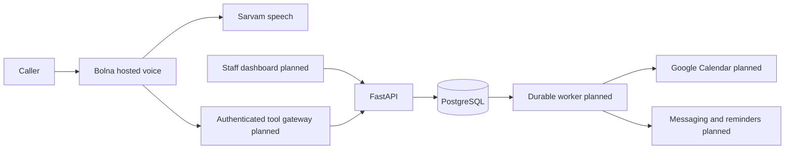

# Architecture

Use a modular monolith with API and worker processes sharing PostgreSQL. Bolna handles telephony and voice orchestration; Sarvam remains behind Bolna's provider interface. No Redis is needed for the initial backend: PostgreSQL owns reservations, durable jobs, and later webhook inbox records. Add infrastructure only when measured demand justifies it.

Only FastAPI, PostgreSQL, local reservations, and outbox insertion exist today. All provider arrows are planned integration boundaries.

## Booking consistency

PostgreSQL is the authoritative reservation ledger. `appointments` uses a GiST exclusion constraint on clinic, doctor, and the `[starts_at, blocks_until)` timestamp range, where `blocks_until` is `ends_at` plus the service buffer snapshotted at booking time (later buffer edits do not move existing holds). This blocks overlapping pending/confirmed/review reservations across services and processes. A unique tenant/idempotency key plus a canonical body hash makes retries replay the same appointment or reject a changed request. A transaction commits the reservation and `calendar.create` outbox entry together. Slot discovery is advisory. A short doctor-row lock orders reservation writes and avoids exclusion-check deadlocks between simultaneous inserts; the range constraint remains the final invariant for every database writer. Schedule exceptions (holidays, leave, breaks) are not covered by the exclusion constraint; instead exception creation takes the same doctor row lock (every clinic doctor in id order for clinic-wide exceptions) and reservations re-check slots, which include exceptions, under that lock, so whichever commits first wins. Existing appointments that overlap a new exception are reported, not cancelled. All scheduling writers follow one lock order, defined in `locks.py`: the reservation's action advisory lock, then the per-clinic doctor-set advisory lock (`doctors:<clinic>`; shared by doctor creation, exclusive for clinic-wide exceptions, so a doctor cannot appear half-way through one), then doctor rows in ascending id. Slot candidates step in absolute (UTC) time from each local opening, so DST transitions neither offer nonexistent local times nor duplicate instants; reservations compare instants. `blocks_until` is derived data: any future reschedule, duration change or status transition back to an active status must recompute it from the booked service's buffer in the same transaction. Migration 005 gives `blocks_until` no default, so a binary older than 005 fails its appointment insert after the migration applies; deploy the new binary with (or before traffic resumes after) the migration. No provider I/O runs under this lock.

The initial API returns 202 `pending_sync`, without patient data. There is no worker today. Pending reservations remain held until explicitly resolved; monitor and clean synthetic development data manually. Do not enable pilot traffic in this state.

The next worker must claim jobs with `FOR UPDATE SKIP LOCKED`, lease expiry, bounded backoff, and a dead-letter/manual-review state. Network I/O must happen outside a long database transaction. Use an opaque deterministic Google event ID derived from appointment ID, recover ambiguous timeouts by fetching that ID, and mark confirmed only after verifying the event. Store provider IDs and state transitions durably. Replays must not duplicate calendar events, messages, or reminders.

Google FreeBusy is not a distributed lock. Before a pilot choose an explicit ownership policy: a clinic-managed dedicated booking calendar plus external busy-calendar reads is preferred. Human edits and external systems can race our ledger; incremental sync/reconciliation and a manual conflict policy are required. Never imply a database constraint prevents external calendar races.

### Calendar port and external busy cache (implemented, ADR 0004)

`providers/calendar.py` defines `CalendarPort` (`get_event`, `insert_event`, `cancel_event`, `free_busy`), the error classes `ProviderTimeout` (outcome unknown), `ProviderRetryable`, `ProviderPermanent` and `EventAlreadyExists` (codes only, never provider bodies), `event_id_for(appointment_id, version)` (`cv<uuid hex>v<version>`; Google allows event ids of 5-1024 characters from base32hex, a-v and 0-9, and the id stays inside that set) and an opaque `event_summary`. `FakeCalendar` is a thread-safe in-memory adapter with timeout and failure injection for tests. No live adapter exists yet (milestone 1, T5), and nothing consumes the outbox yet (T4).

Migration 006 adds `doctors.booking_calendar_id` (the dedicated calendar the system writes to; NULL = not mapped) and `doctors.busy_calendar_ids` (up to 10 read-only advisory calendars), plus the `external_busy` cache (clinic, doctor, interval, source, `fetched_at`). `calendar_sync.refresh_external_busy` fetches FreeBusy for the doctor's calendars (including the booking calendar, whose own events then appear busy; harmless because those times are already blocked locally), then replaces the doctor's cached rows overlapping the window in one transaction. Provider errors propagate before any write. `busy_intervals` unions the cache, so `check-slots` and the reservation re-check under the doctor lock treat cached external busy time like any other busy interval (a reservation over it returns 409). The cache is advisory and as stale as its last refresh; no job refreshes it yet.

## Planned tenant boundary

Each tool bearer token is a `tenant_credentials` record owned by exactly one clinic (ADR 0002); tenant identity is never read from tool arguments. All current catalog/appointment reads filter by clinic; composite foreign keys prevent cross-clinic doctor/service references. Staff users and sessions (ADR 0003) belong to one clinic, and staff management derives the tenant from the session. This is still not complete multi-tenant auth: next put clinic configuration behind these roles, then add gateway-verified call/session context. Consider PostgreSQL RLS as defense in depth, with isolated role tests, before a pilot.

Caller ID is untrusted. Do not greet with private booking information or allow cancellation using only a phone number. Add a clinic-approved verification mechanism and handle shared phones. Never ask an LLM to decide tenant identity or invent idempotency keys.

## Provisioning and lifecycle

Plan onboarding as a recoverable state machine: draft → calendar_connected → agent_created → number_assigned → verified → active, with failed/manual-review states. Persist provider IDs after each step, reconcile uncertain results, and never buy a second number on a blind retry. Connect existing clinic numbers only after routing ownership is verified.

Booking lifecycle: pending_sync → confirmed or needs_review; confirmed → cancellation_pending/reschedule_pending → resolved. New states require migrations and business tests. Reserve the new slot before releasing the old one; keep the original booking when a reschedule fails. Use appointment versions to suppress stale reminders after rescheduling/cancellation.

## Webhook and data boundaries

Plan a dedicated authenticated inbox: validate custom secret header, map agent/execution to tenant on the server, enforce body size, redact/minimize payload, persist before 2xx, process asynchronously. Deduplicate by provider event ID or execution+status+payload hash; execution ID alone drops later state updates. Reject regressions after terminal state. Poll executions to reconcile missing deliveries; do not rely on vendor retries.

No clinical notes in calendar titles, prompt variables, logs, or analytics. Use opaque booking references and minimum operational information. Encrypt refresh tokens with managed keys; separate retention for appointment metadata, recordings, transcripts, and audit records. Recording storage is disabled by default in the planned integration.
